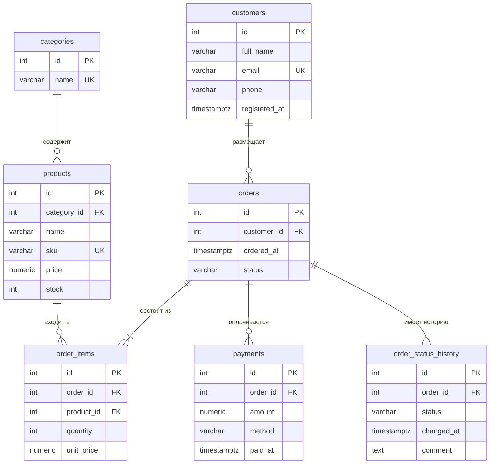

# Лабораторная работа №1. Интернет-магазин (PostgreSQL)

## Запуск

Требуется PostgreSQL и `make`. Подключение: пользователь `postgres`, хост `localhost`, БД `lab1` (меняется через `DB`, `DB_USER`, `HOST`).

    make            # создать БД (если нет), схема, данные, проверка ограничений
    make rebuild    # то же, но сначала стирает все данные (только до migration.sql!)

Отдельные шаги: `make createdb`, `make reset`, `make schema`, `make data`, `make test`.

`make test` пишет результат в `constraints_test.log` и проверяет, что отклонены все 15 некорректных операций.

Миграция (`make rebuild`):

    psql -U postgres -h localhost -d lab1 -v ON_ERROR_STOP=1 -f migration.sql

# ER-диаграмма

PK — первичный ключ, FK — внешний ключ, UK — уникальное значение.

## Связи

Все связи «один ко многим»; `orders` ↔ `products` — «многие ко многим» через `order_items`.

| Связь | Кратность |
|---|---|
| `customers` → `orders` | 1 : N |
| `categories` → `products` | 1 : N |
| `orders` → `order_items` | 1 : N |
| `products` → `order_items` | 1 : N |
| `orders` → `payments` | 1 : N |
| `orders` → `order_status_history` | 1 : N |

